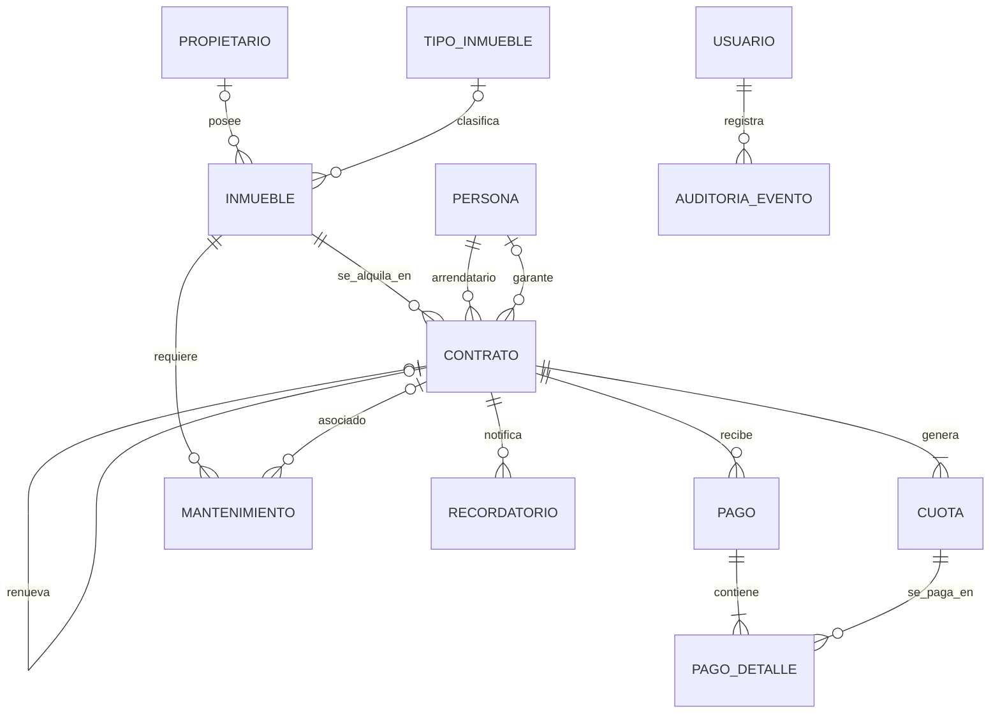

# Plan maestro — Sistema de Gestión de Alquileres

## 1. Visión

Un sistema de escritorio que reemplaza el cuaderno y el Excel de quien administra inmuebles en alquiler. Debe responder rápido a cuatro preguntas:

1. **¿Qué inmuebles tengo y cuáles están ocupados?**
2. **¿Quién me debe y cuánto?** (con mora calculada automáticamente)
3. **¿Qué contratos vencen pronto?**
4. **¿Cuánto cobré y cuánto gasté por inmueble?**

Mismo nivel visual y técnico que el sistema de referencia (dashboard, menú lateral, tablas con paginación, formularios tipo drawer, PDF y Excel, modo oscuro).

## 2. Detalles propios (lo que lo hace distinto de "otro sistema de gestión")

- **Semáforo de morosidad** por arrendatario/contrato (verde, amarillo, rojo).
- **Mora automática** con días de gracia, calculada al momento del pago, con opción de condonarla.
- **Cronograma de cuotas** generado al crear el contrato (con incremento anual opcional).
- **Recordatorios por WhatsApp**: mensaje listo para copiar o abrir en WhatsApp, con registro de cuándo se envió.
- **Estado de cuenta en PDF** por contrato.
- **Rentabilidad por inmueble** (ingresos cobrados menos gastos de mantenimiento).
- **Respaldo y restauración** de la base de datos desde la propia aplicación.

## 3. Mapa de navegación (menú lateral)

El menú completo existe desde la Fase 0 (los módulos aún no construidos muestran una vista "Próximamente"). Cada fase reemplaza un placeholder por su pantalla real.

```text
GENERAL
  Dashboard                      (Fase 4)
CONTRATOS
  Nuevo contrato                 (Fase 2)
  Contratos                      (Fase 2)
COBRANZA
  Nuevo pago                     (Fase 3)
  Pagos                          (Fase 3)
  Cuentas por cobrar             (Fase 3)
MANTENIMIENTO
  Mantenimiento                  (Fase 5)
  Rentabilidad                   (Fase 5)
CATÁLOGO
  Inmuebles                      (Fase 1)
  Tipos de inmueble              (Fase 1)
  Personas                       (Fase 1)
  Propietarios                   (Fase 1)
── pie del menú ──
  Configuración                  (Fase 7)
  Modo oscuro                    (Fase 0)
  Contraer menú                  (Fase 0)
```

## 4. Modelo de datos general



Tablas de soporte: `secuencia` (numeraciones), `configuracion` (Fase 7), `usuario` y `auditoria_evento` (Fase 7), `recordatorio` (Fase 6).

## 5. Ciclo de vida de los estados

**Inmueble:** `DISPONIBLE` ⇄ `ALQUILADO` (solo por contratos) · `MANTENIMIENTO` · `INACTIVO`.

**Contrato:** `VIGENTE` → `FINALIZADO` | `RESCINDIDO`. Estados visuales derivados (no se guardan): *Por vencer* (vigente y faltan ≤ N días) y *Vencido* (vigente con fecha fin pasada).

**Cuota:** `PENDIENTE` → `PARCIAL` → `PAGADA` | `ANULADA`. *Vencida* es un estado visual derivado.

**Pago:** `EMITIDO` → `ANULADO`.

**Mantenimiento:** `REPORTADO` → `EN_PROCESO` → `RESUELTO` | `CANCELADO`.

## 6. Fases

| Fase | Nombre | Resultado visible |
|---|---|---|
| 0 | Cimientos y shell | App que abre con el diseño idéntico al referente, menú completo, modo oscuro persistente |
| 1 | Catálogos | CRUD de Inmuebles, Tipos, Personas y Propietarios |
| 2 | Contratos y cronograma | Crear/renovar/finalizar contratos; cuotas generadas |
| 3 | Cobranza | Pagos con mora, recibo PDF, cuentas por cobrar |
| 4 | Dashboard | Indicadores, gráficos, semáforo de morosidad, exportar Excel |
| 5 | Mantenimiento y rentabilidad | Incidencias, gastos, rentabilidad por inmueble |
| 6 | Reportes, documentos y recordatorios | PDFs, Excel completos, WhatsApp |
| 7 | Configuración, seguridad y entrega | Parámetros, login y roles, respaldo, instalador |

**Versión presentable mínima (MVP): Fases 0 a 4.** Con eso ya hay catálogo, contratos, cobranza con mora, recibo PDF y dashboard, que es el núcleo equivalente al sistema del docente. Las fases 5 a 7 elevan el proyecto a nivel profesional.

Cada fase deja la aplicación **funcionando y ejecutable**. Nunca se pasa a la siguiente con la anterior rota.

## 7. Cómo usar estos documentos con Codex

Estructura sugerida en la carpeta del proyecto nuevo (`gestion-alquileres/`):

```text
gestion-alquileres/
├── AGENTS.md                       ← Codex lo lee automáticamente
└── docs/
    ├── 00_PLAN_MAESTRO.md
    ├── DISENO_UI.md
    ├── PROGRESO.md
    ├── ANALISIS_PROYECTO.md        ← copia del análisis del referente
    └── fases/FASE_00_… a FASE_07_….md
```

El proyecto de referencia debe estar accesible en `../crud-persona-spring/` (carpeta hermana, solo lectura). Si está en otra ruta, cámbiala en la sección 2 de `AGENTS.md`.

Para cada fase, pega en Codex el bloque **"Prompt para Codex"** que está al final del archivo de esa fase. Revisa el resultado, prueba la app, marca el avance en `PROGRESO.md` y recién entonces pasa a la siguiente fase.

## 8. Fuera de alcance (a propósito)

IGV y facturación electrónica SUNAT, multimoneda (solo soles), multiusuario concurrente en red, aplicación web o móvil, firma digital de contratos, pasarelas de pago. El diseño no lo impide, pero no se construye.
