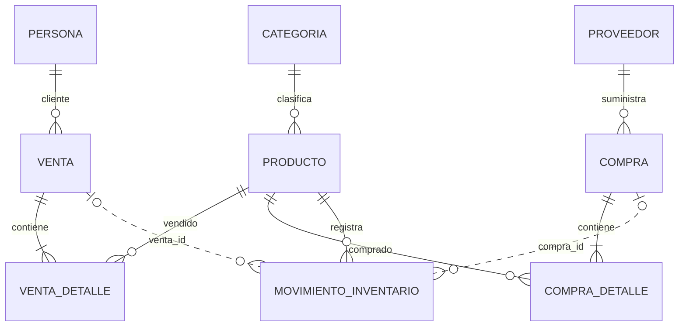

# Análisis del proyecto

> Alcance: inspección estática del contenido de `crud-persona-spring/`. Las rutas siguientes son relativas a esa carpeta salvo que se indique lo contrario. No se ejecutó ni modificó el proyecto para elaborar este análisis. Cuando el código no permite sostener un dato se indica **No confirmado**.

## 1. RESUMEN GENERAL

Aplicación de escritorio para gestión comercial de un negocio pequeño/mediano: catálogo de productos y categorías, personas/clientes y proveedores, ventas con comprobante, compras, existencias y kardex, panel de indicadores y exportación de reportes. La UI es JavaFX declarativa (FXML), con controladores Java; Spring Boot se usa como contenedor de dependencias y JPA, sin servidor web (`src/main/resources/application.properties`).

El público objetivo inferible son operadores de punto de venta, administración y almacén de un comercio en Perú: la aplicación usa soles, DNI/RUC, IGV y series de boleta. El uso en producción, cantidad de usuarios y sector comercial exacto son **No confirmado**. El nombre Maven `crud-persona-spring` conserva una denominación más limitada que el alcance actual.

## 2. STACK TECNOLÓGICO

- **Lenguaje:** Java. El POM apunta a Java 17 (`pom.xml`, propiedad `java.version=17`); la versión efectivamente instalada/usada en ejecución es **No confirmado**.
- **Interfaz:** JavaFX Controls y FXML 21.0.4, AtlantaFX Base 2.0.1 (tema Primer), Ikonli JavaFX y Feather Pack 12.3.1.
- **Framework / persistencia:** Spring Boot 3.3.4 como parent; Spring Data JPA, Bean Validation, Hibernate ORM con dialectos comunitarios y Lombok opcional.
- **Build:** Maven, proyecto `com.ejemplo:crud-persona-spring:1.0.0`, wrapper `mvnw` y `mvnw.cmd`; plugins Spring Boot y JavaFX Maven Plugin 0.0.8. No se encontró configuración Gradle.
- **Persistencia:** SQLite mediante Xerial `sqlite-jdbc` 3.45.3.0. Hibernate `SQLiteDialect` (artifact `hibernate-community-dialects`, versión gestionada por Spring Boot; la versión resuelta no se confirma sin inspeccionar el árbol de dependencias). URL `jdbc:sqlite:persona.db`; Hikari máximo 1 conexión. `spring.jpa.hibernate.ddl-auto=update`, SQL visible y `open-in-view=false` (`src/main/resources/application.properties`). No hay migraciones Flyway/Liquibase ni pool dedicado adicional.
- **PDF:** OpenPDF 1.3.43 (`ComprobantePdfService`).
- **Excel:** Apache POI `poi-ooxml` 5.2.5 (`ReporteExcelService`, `ReporteInventarioExcelService`, `LibroExcel`).
- **Gráficos:** JavaFX Charts integrado en JavaFX; no se declara biblioteca de gráficos externa.
- **Logs y pruebas:** logging mediante API de Spring Boot/SLF4J; configuración por niveles en `application.properties`. `spring-boot-starter-test` en alcance test. Existen pruebas de integración y unitarias bajo `src/test/java`.
- **Iconos/estilos:** Feather por Ikonli; CSS propio `src/main/resources/css/app.css` y tokens de AtlantaFX. No se identifica fuente externa empaquetada.

## 3. ESTRUCTURA DEL PROYECTO

```text
crud-persona-spring/
├── pom.xml, mvnw, mvnw.cmd              build Maven
├── persona.db, identifier.sqlite        archivos SQLite presentes en la carpeta
└── src/
    ├── main/java/com/ejemplo/crudpersona/
    │   ├── Launcher.java, *Application.java  arranque Spring/JavaFX
    │   ├── config/                       datos de empresa
    │   ├── controller/                   controladores de pantallas
    │   ├── exception/                    excepción de negocio
    │   ├── model/                        entidades y enumeraciones JPA
    │   ├── repository/                   interfaces Spring Data y consultas
    │   ├── seeder/                       carga inicial/datos demostrativos
    │   ├── service/                      casos de uso, cálculos y reportes
    │   └── ui/                           utilidades reutilizables de interfaz
    ├── main/resources/
    │   ├── application.properties
    │   ├── css/app.css
    │   └── view/*-view.fxml
    └── test/java/com/ejemplo/crudpersona/
        └── service/ y prueba de contexto
```

**Arquitectura:** capas tipo MVC con separación adicional de servicios y repositorios. FXML declara nodos; `controller` responde eventos y coordina vistas; `service` concentra operaciones/cálculos y transacciones; `repository` usa Spring Data JPA y JPQL; `model` representa entidades. `ui` ofrece paginación, tablas, formularios, notificaciones, autocompletado y exportador de archivos. Los controladores reciben servicios por inyección de constructor/Lombok. No es una aplicación Spring MVC web.

**Arranque:** `Launcher.main` delega a `CrudPersonaSpringApplication`; la clase principal arranca Spring y `JavaFxApplication` integra el ciclo de vida JavaFX. `JavaFxApplication.start` carga `/view/main-view.fxml`, aplica AtlantaFX Primer Light y CSS. `MainController` carga las vistas de módulos y maneja navegación y tema. La configuración desactiva el modo web. La identidad exacta de cada orden de inicialización puede consultarse en `Launcher.java`, `CrudPersonaSpringApplication.java` y `JavaFxApplication.java`.

## 4. DISEÑO VISUAL Y UI

- `src/main/resources/view/main-view.fxml` define la ventana principal; `MainController` configura navegación lateral, vista de contenido y controles. Carga por nombre FXML (`/view/<nombre>.fxml`) y mantiene referencias a pantallas refrescables.
- Navegación lateral agrupada por módulos; `MainController.onContraerMenu` implementa contraer/expandir y `onCambiarTema` alterna Primer Light/Dark. El estado persistente de tema entre ejecuciones es **No confirmado**; el código lo cambia en la raíz durante la sesión.
- AtlantaFX aporta tokens de color base. CSS propio con clases `.app`, `.sidebar`, `.nav-item`, `.pagina`, `.tarjeta`, `.tabla`, `.drawer`, `.dialogo`, `.chip`, `.kpi`, etc. El modo oscuro reutiliza tokens y redefine colores de series bajo `.app.dark`.
- Valores visibles en CSS: fondo/acentos de series modo claro `#2a78d6`, `#eb6834`, `#1baf7a`, `#eda100`, `#e87ba4`, `#008300`, otros `#9a9994`; oscuro `#3987e5`, `#d95926`, `#199e70`, `#c98500`, `#d55181`, `#008300`, otros `#6e6d68`. Colores generales como `-color-bg-default` dependen del tema; sus HEX exactos aquí son **No confirmado**.
- Tipografía declarada por CSS: familia no especificada (usa predeterminada), base 13 px; títulos de página 26 px, KPI 28 px, texto de marca 16 px. Espaciados típicos: página 30/34/26 px, tarjeta 20/22/18 px; radios de tarjetas 16 px, botones/inputs 8–10 px y diálogo 18 px. Sombras gaussianas para tarjetas, drawer y diálogos.
- Componentes compartidos: `Tablas` (celdas de moneda, stock, estado, avatar y vacío), `Paginador`, `Formularios`, `Notificador`, `Autocompletar`, `CeldasCarrito`, `Refrescable`, `Exportador`; estilos en `app.css`. KPI/gráficos del dashboard se implementan principalmente en `DashboardController` y `dashboard-view.fxml`.
- Iconografía: `org.kordamp.ikonli:ikonli-feather-pack`, referencias `Feather.*`.
- Responsive: existen contenedores scroll y layout JavaFX con prioridades de crecimiento; adaptación a breakpoints/dispositivos no confirmada. El menú contraíble sí está implementado.

## 5. PANTALLAS Y MÓDULOS

| Módulo | Vista / controlador | Funciones y servicios principales |
|---|---|---|
| Dashboard | `dashboard-view.fxml`, `DashboardController` | Indicadores de catálogo/personas, visualizaciones de productos y ventas, exportación de ventas, actualización y acceso a ventas. Usa `DashboardService` y `ReporteVentasService`; impresión desde últimas ventas vía `ComprobantePdfService`. |
| Nueva venta / punto de venta | `punto-venta-view.fxml`, `PuntoVentaController` | Selección/autocompletado de cliente y productos, carrito, cantidades, IGV y registro de comprobante; usa `VentaService`, `PersonaService`, `ProductoService`, `CalculadoraIgv`. |
| Ventas | `ventas-view.fxml`, `VentasController` | Listado paginado/filtrado, resumen, detalle, PDF, Excel y anulación; `VentaService`, `ReporteVentasService`, `ReporteExcelService`, `ComprobantePdfService`. |
| Nueva compra | `compra-form-view.fxml`, `CompraFormController` | Proveedor por RUC/autocompletado, documento de proveedor, productos, costos, IGV, carrito y registrar; `CompraService`, `ProveedorService`, `ProductoService`. |
| Compras | `compras-view.fxml`, `ComprasController` | Historial, detalle, anulación y exportación; `CompraService` / `ReporteInventarioExcelService`. |
| Inventario | `inventario-view.fxml`, `InventarioController` | Existencias, alertas, reposición que inicia flujo de compra, kardex y Excel; `InventarioService`, `ProductoService`, `ReporteInventarioExcelService`. |
| Personas | `persona-view.fxml`, `PersonaController` | CRUD, búsqueda/paginación y validación; `PersonaService`. Estas personas se usan como clientes. |
| Categorías | `categoria-view.fxml`, `CategoriaController` | CRUD, listado/paginación y validación; `CategoriaService`. |
| Productos | `producto-view.fxml`, `ProductoController` | CRUD, categoría, precio, stock mínimo y búsqueda; `ProductoService` y `CategoriaService`. |

La existencia y propósito de cada pantalla se corroboran en FXML/controladores indicados; detalles de acciones particulares pueden consultarse en sus métodos `on...`.

### Dashboard

Hay dos conjuntos de resumen. El resumen de catálogo (`DashboardService.obtenerResumen`) suma precios de catálogo como valor, calcula precio promedio, cuenta personas/categorías/productos, presencia de email/teléfono, agrupa productos por categoría y rangos `<10`, `10–<50`, `50–<100`, `100–<500`, `500–<1000`, `>=1000`, y devuelve cinco productos más caros. `DashboardController` dibuja dona por categoría, barras de precios y rangos, medidores de contacto y ranking de productos.

El resumen de ventas (`ReporteVentasService.resumen`) admite `Periodo`/fechas; contiene base, IGV, total y comprobantes, serie diaria o mensual, productos vendidos, clientes frecuentes y ventas recientes. El controlador muestra KPI de ventas, ticket promedio por comprobante emitido, ventas anuladas, base imponible, gráfico de tendencia, top productos/clientes y últimas ventas con botón PDF. La agregación y el filtro excluyen anuladas en consultas de ventas; la fórmula exacta de comparación contra periodo anterior es **No confirmado** sin evidencia de la consulta correspondiente. El filtro se construye con periodos disponibles en `Periodo` y fechas; el detalle de opciones de UI está en `dashboard-view.fxml`.

## 6. MODELO DE DATOS

Entidades JPA (tipos de columna derivados de Java y anotaciones; SQLite/Hibernate puede materializarlos con afinidad propia):

| Tabla | Clave/columnas principales | Relaciones, restricciones e índices |
|---|---|---|
| `persona` | `id` Long; nombre/apellido, `dni`, email, teléfono String | DNI único `uk_persona_dni`; validación DNI de 8 dígitos. |
| `proveedor` | `id`; RUC, razón social, dirección, teléfono | RUC único; RUC 11 dígitos con prefijos validados. |
| `categoria` | `id`; nombre, `codigo_categoria`, descripción | código único `uk_categoria_codigo`. |
| `producto` | `id`; nombre, `codigo_producto`, descripción, precio BigDecimal(10,2), stock Integer default 0, `stock_minimo` default 5, `costo_promedio` BigDecimal(12,4) | código único; `categoria_id` nullable a `categoria`. |
| `venta` | `id`; tipo, serie, número, comprobante, fecha, IGV/aplica/precios incl., tasa, base, IGV, total, estado, observación | cliente obligatorio a `persona`; comprobante único; índice fecha; cascade a detalles. |
| `venta_detalle` | `id`, item, cantidades, copia código/nombre, precio unitario e importe | venta y producto obligatorios (`venta_id`, `producto_id`). |
| `compra` | `id`; código/número/fecha, proveedor, tipo/número/fecha documento, flags IGV, tasa, base, IGV, total, estado, observación | proveedor obligatorio; código único; índice fecha; cascade detalles. |
| `compra_detalle` | `id`, compra, item, producto, copia código/nombre, cantidad, costo unitario e importe | compra y producto obligatorios. |
| `movimiento_inventario` | `id`; fecha, producto, tipo, cantidad, stock resultante, costo unitario nullable, documento, `venta_id`/`compra_id` opcionales | índice `(producto_id, fecha)`, índice `venta_id`, índice `compra_id`; referencias venta/compra guardadas como IDs simples, no como asociaciones JPA declaradas. |

Las entidades están en `src/main/java/com/ejemplo/crudpersona/model/`. Todas las entidades usan `id` autogenerado IDENTITY. No se observan índices únicos compuestos adicionales, checks SQL ni restricciones explícitas para unicidad de `item`; si existen en el archivo SQLite, no se pueden atribuir al código de entidades. Enumeraciones persistidas como texto (`EnumType.STRING`).



No hay scripts DDL versionados encontrados. Hibernate actualiza esquema por `ddl-auto=update`. `DatabaseSeeder` y clases `*Seeder` crean datos de ejemplo; `app.seeder.enabled=true` está activo por defecto. `persona.db` y `identifier.sqlite` están presentes; su contenido/relación y si son datos distribuidos no se confirma aquí.

## 7. LÓGICA DE NEGOCIO IMPORTANTE

- `CalculadoraIgv` centraliza el cálculo. Tasa configurada/definida en código; la venta/compra guarda la tasa aplicada, base, IGV y total para preservar el comprobante histórico. Tiene pruebas `CalculadoraIgvTest`. `CalculadoraIgv.TASA_IGV` está fijada en 0.18 (18%); si los precios incluyen IGV, se obtiene la base dividiendo entre 1 + tasa, y el impuesto es la diferencia; si no lo incluyen, se calcula base × tasa. Redondeo HALF_UP a dos decimales.
- Ticket promedio: total de ventas emitidas dividido entre cantidad de comprobantes emitidos en resumen; el controlador lo rotula “Promedio por comprobante emitido”. `ReporteVentasService.ResumenVentas` incluye la variación porcentual del total frente al periodo anterior de igual duración (nula si no hay base); `DashboardController` muestra el porcentaje y la leyenda “vs. periodo anterior”.
- `VentaService` valida tipo, cliente, líneas, cantidades y precios; obtiene productos, verifica stock del carrito agrupado, guarda venta y genera movimientos de salida dentro de `@Transactional`. Numeración por serie consultando máximo y sumando uno; formato serie-número con ocho dígitos. `uk_venta_comprobante` protege duplicidad en DB, pero no se ve una estrategia de bloqueo para concurrencia entre dos registros simultáneos.
- Anular venta cambia estado a ANULADA y registra entrada al kardex por cada detalle; no borra el documento. `CompraService` registra entradas, actualiza costo promedio ponderado (ver `InventarioService`) y al anular retira el stock, si hay unidades suficientes; de lo contrario rechaza la anulación.
- `InventarioService` centraliza disponibilidad y movimientos; entidades `TipoMovimiento` distinguen COMPRA, VENTA, ANULACION_VENTA y ANULACION_COMPRA. No se confirma control de concurrencia pesimista/optimista; SQLite con pool 1 reduce conexiones locales, pero no prueba exclusión entre procesos.
- Validaciones se expresan con Jakarta Validation y comprobaciones de negocio lanzan `NegocioException`; UI muestra notificaciones/diálogos mediante utilidades `ui`. Se registran operaciones con SLF4J. Estrategia uniforme para errores de persistencia no confirmada.
- Transacciones declaradas en servicios de escritura y seeders. La atomicidad concreta depende del transaction manager JPA de Spring.

## 8. REPORTES Y EXPORTACIONES

`ComprobantePdfService` usa OpenPDF para construir un comprobante con datos de `DatosEmpresa`, venta y detalle, incluyendo montos y conversión a letras (`NumeroALetras`). `VentasController` y `DashboardController` lo invocan; `Exportador` permite guardar/abrir archivos temporales. No se encontró plantilla PDF externa: se construye por código.

`ReporteExcelService` genera libro `.xlsx` de ventas, con resumen, ventas, detalle, productos y clientes; `ReporteInventarioExcelService` genera hojas de inventario/kardex y compras. Ambos usan Apache POI; `LibroExcel` concentra estilos y operaciones compartidas. Las consultas/agregados provienen de `ReporteVentasService`, repositorios y servicios de inventario/compra.

## 9. CONFIGURACIÓN, SEGURIDAD Y OTROS

Configuración principal en `src/main/resources/application.properties`; datos de emisor están en texto plano en propiedades (`app.empresa.*`). Son valores empresariales de muestra/configuración y no se confirma que sean credenciales reales. No hay autenticación, usuarios o roles identificados en fuentes revisadas. No se declara cifrado de base local ni gestión de secretos.

Logging: raíz WARN, paquete propio INFO, SQL Hibernate DEBUG y `show-sql=true`, lo que puede imprimir consultas SQL. No se identifica configuración de archivo rotativo. Empaquetado: plugin Spring Boot y JavaFX configurados con main `com.ejemplo.crudpersona.Launcher`; se puede ejecutar Maven wrapper. Jar ejecutable final, instalador, `jpackage`, firma y distribución: **No confirmado** (no hay configuración identificada para instalador).

## 10. EVALUACIÓN CRÍTICA

**Fortalezas observables:** responsabilidades separadas en controladores/servicios/repositorios; operaciones críticas transaccionales; uso de `BigDecimal`; snapshot de nombres/códigos y montos en detalles; kardex con saldo resultante; anulación reversible con movimientos; validación de formularios/negocio; utilidades UI compartidas; pruebas para IGV, letras, ventas e inventario; consultas específicas y reportes útiles.

**Riesgos y mejoras recomendadas:** SQLite local y pool de una conexión limitan escenarios multiusuario; el correlativo basado en `MAX + 1` puede competir en concurrencia, aunque haya constraint; `ddl-auto=update` no ofrece evolución reproducible como migraciones; SQL DEBUG y seeders activos no son prudentes como configuración de distribución sin perfil de producción; no se identifica autenticación/roles, respaldo/restauración ni estrategia de actualización de datos. Ampliar pruebas de interfaz, anulaciones, redondeos y concurrencia; considerar migraciones y configuración por entorno. Confirmar el uso efectivo de `identifier.sqlite` y política de los archivos DB.

**Reutilizable para otro sistema:** shell JavaFX, navegación lateral, tema Primer claro/oscuro, CSS, formularios drawer, tablas/paginación, notificaciones, selector/exportador, inyección Spring, separación service/repository, logging y estructura de pruebas.

**Específico de comercio/ventas:** IGV, comprobantes y correlativos, carrito, clientes, compras a proveedor, costos, stock/kardex, ventas/anulaciones y sus reportes. Para alquileres se reemplazarían modelos y casos de uso por inmuebles, contratos, arrendatarios, pagos, vencimientos y mantenimiento; el shell UI y utilidades pueden conservarse.

## 11. GUÍA DE REUTILIZACIÓN

**Copiar como base:** `pom.xml` (ajustando coordenadas y dependencias), `Launcher`/integración JavaFX-Spring, `MainController`, `main-view.fxml`, `app.css`, patrón `controller → service → repository`, `Refrescable`, `Tablas`, `Paginador`, `Formularios`, `Notificador`, `Autocompletar` y patrón de pruebas. Mantener AtlantaFX/Ikonli si se desea la misma identidad visual.

**Pasos sugeridos:**

1. Crear proyecto Maven con Java 17, Spring Boot, JavaFX/FXML, validación y persistencia elegida.
2. Reproducir los paquetes `model`, `repository`, `service`, `controller`, `ui`, `config` y `exception`; sustituir entidades y reglas comerciales.
3. Arrancar Spring y JavaFX mediante el mismo patrón `Launcher` + `JavaFxApplication`; separar la configuración de datos por entorno y añadir migraciones.
4. Adaptar `main-view.fxml` y navegación; conservar tema, componentes CSS y controles genéricos.
5. Crear entidades/repositorios/servicios de dominio nuevos, con transacciones y validaciones; evitar copiar IGV, comprobantes y lógica de stock si el dominio no los requiere.
6. Adaptar exportaciones al nuevo dominio y cubrir con pruebas las operaciones que cambian dinero/estado.

### Evidencia principal

- Build/dependencias: `pom.xml`; configuración: `src/main/resources/application.properties`.
- Arranque y shell: `src/main/java/com/ejemplo/crudpersona/{Launcher.java,CrudPersonaSpringApplication.java,JavaFxApplication.java,controller/MainController.java}`.
- UI: `src/main/resources/view/`, `src/main/resources/css/app.css`.
- Datos y reglas: `model/`, `repository/`, `service/`; reportes: `ComprobantePdfService.java`, `ReporteExcelService.java`, `ReporteInventarioExcelService.java`.
- Pruebas: `src/test/java/com/ejemplo/crudpersona/service/`.

